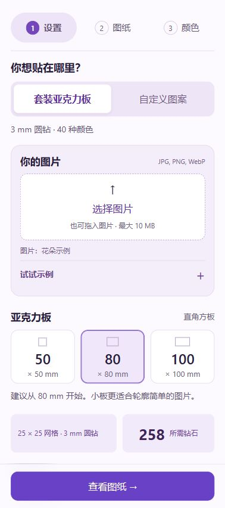

# WALLFID Rhinestone Studio

[简体中文](README.md) · [English](README.en.md) · **日本語**

好きな画像を番号付きのラインストーン図案に変えて、自分の手で作品にする。
WALLFID Rhinestone Studio は、40 色のキットと直径 3 mm の丸型ラインストーンに対応した、ブラウザーで動く静的サイトです。キットのアクリル板または任意のサイズを選び、元画像と仕上がりイメージを比較して、制作に使う図案を保存できます。

**サイトを開く：** [ブランドサイト](https://wallfid.pages.dev/) · [GitHub Pages](https://niuzipai-gif.github.io/wallfid-rhinestone-studio/) · [ソースコード](https://github.com/niuzipai-gif/wallfid-rhinestone-studio)


## 画像から図案を作る

1. **制作サイズを選ぶ。** 50・80・100 mm の正方形アクリル板を選ぶか、幅と高さを指定します。
2. **画像を読み込む。** 10 MB 以下、デコード後 2,400 万画素以下の JPG・PNG・WebP に対応。画像全体を収めるほか、切り抜き、拡大率、位置を調整できます。
3. **変換結果を確認する。** 元画像と比較し、フルカラーと輪郭モードを切り替えて、色ごとの必要数を確認します。
4. **保存して制作する。** 番号付き PNG、必要数の CSV、または実寸の印刷用ガイドを出力します。

選択した画像はブラウザー内で読み込まれます。アプリから画像アップロードサービスや画像生成サービスへ送信する仕組みはありません。


比較画面には、加工前の元画像と現在適用されている図案を表示します。比較画面を開いても、図案、必要数、選択中の色、プレビューの拡大率は変わりません。

## 主な機能

- **実物と共通の色番号：** プレビュー、番号付き図案、必要数、収納ケースの位置を同じ 40 色の番号で対応付けます。
- **縦横比を保つ配置：** 初期設定では画像全体を収めます。余った部分にはストーンを置かず、必要に応じて板いっぱいに切り抜けます。
- **カスタム図案：** 幅・高さは 12～600 mm。画像のシルエット、長方形、円・楕円、ハートの形に対応します。
- **2 種類の表現：** フルカラー、または主要な境界を残してほかのマスを空ける輪郭モードを選べます。
- **色と輪郭を考慮した処理：** シンプルなイラストでは、主要な色のまとまりや線のつながりを保ちながら固定パレットに割り当てます。
- **暗い写真の補正：** サンプリング時に明るい部分の細部を残すための補正を、必要に応じて切り替えられます。
- **制作に使える出力：** 番号付き PNG、色別の必要数をまとめた CSV、実寸印刷に対応。大きな図案は A4 用紙に分割できます。
- **スマートフォンと PC に対応：** スマートフォンでは設定 → 図案 → 色の順に進みます。画像の選択は制作面の選択直後、アクリル板のサイズより前に配置しています。大きな画面では制作画面全体を使えます。

スマートフォンでは画像を選んでからサイズを決められます。サンプルや画像を選ぶと図案が開きます。図案の下でも板のサイズ、任意の幅・高さ、図案のスタイルを変更でき、設定画面に戻る必要はありません。サンプルと画像調整は必要なときに展開でき、グリッドと必要なストーン数は横並びで確認できます。画面幅を切り替えても画像と設定は保持されます。



## アクリル板と実際のマス数

キットの板は、角を丸めていない透明な正方形アクリル板です。初期設定の **中心間隔 3 mm** では、実物に合わせて確認したマス数は次のとおりです。

| 板のサイズ | マス数 | 最大配置数 |
| --- | --- | ---: |
| 50 × 50 mm | 15 × 15 | 225 |
| 80 × 80 mm | 25 × 25 | 625 |
| 100 × 100 mm | 32 × 32 | 1,024 |

これは配置できるマスの上限です。すべての図案で全マスを使うわけではありません。透明部分、背景除去、輪郭モードによって空きマスが生じます。間隔を広げると、配置できるマス数は減ります。

印刷時は **100%／実際のサイズ** を選び、ヘッダーとフッターをオフにしてください。使う前に、印刷した **50 mm の確認線** を定規で測ります。「用紙に合わせる」を選ぶと実寸が変わります。

## 40 色の基準


番号は **左上から右へ、行ごとに** 進みます。1～8、9～16、17～24、25～32、33～40 の順です。実物の色もこの並びを保ってください。色ガイドのサムネイルには、実物写真を切り出した画像を使用しています。

パレットのバージョン：`physical-sample-2026-10-13-row-major-40-v2`。
RGB 値は、強い反射や明るい裏面をできる限り除き、表面・本体の色を写真から推定したものです。測色機器による校正値ではありません。反射するストーンやオーロラ系のストーンは照明でも見え方が変わるため、**ケースの番号** を合わせてから実物の色を確認してください。

## はじめての貼り付け

制作する面をきれいにし、十分に乾かします。アクリル板は保護フィルムをはがし、実寸を確認した図案を板の下に固定します。サイトの 6 ステップ教材は実際の制作写真を使用しており、写真をタップすると拡大できます。

<table>
  <tr>
    <td width="33%"><br><strong>1. 少量の接着剤を塗る</strong><br>一度に小さな範囲だけを進めます。</td>
    <td width="33%"><br><strong>2. 細い丸型のペン先を確認する</strong><br>写真の細い金属側を使います。</td>
    <td width="33%"><br><strong>3. パテを付ける</strong><br>先端をシリコンパテに軽く押し込み、1 回転させます。</td>
  </tr>
  <tr>
    <td><br><strong>4. 先端の状態を確認する</strong><br>丸い先端を少量のパテで覆います。</td>
    <td><br><strong>5. 1 粒を拾う</strong><br>カット面に触れて拾い、平らな裏面を接着面に向けます。</td>
    <td><br><strong>6. 置いて軽く押さえる</strong><br>裏面全体が板の内側に収まる位置に置き、軽く押してペンを離します。</td>
  </tr>
</table>

シリコンパテはストーンを **拾うため**、接着剤は制作面に **固定するため** に使います。接着剤の使い方と硬化時間は、製品ラベルの指示に従ってください。

**A5 両面の実技ガイド** をダウンロード：[英語 PDF](assets/tutorial/WALLFID-hands-on-EN.pdf) · [中国語 PDF](assets/tutorial/WALLFID-hands-on-ZH.pdf)。

## 表示言語

画面は **28 言語** に対応しています。EU の公用語 24 言語に、簡体字中国語、繁体字中国語、日本語、韓国語を加えた構成です。現在の翻訳は初版であり、母語話者による校正はまだ完了していません。

言語を変更しても、読み込んだ画像、板のサイズ、図案は保たれます。選択した言語はブラウザー内に保存します。翻訳には同梱の辞書を使い、選択した画像を翻訳サービスへ送ることはありません。

写真付きの詳しい実技教材は **英語・簡体字中国語・繁体字中国語** を用意しています。それ以外の表示言語では、この教材部分は現在英語で表示されます。A5 PDF は英語版と中国語版です。

## ローカルで動かす

リポジトリ直下をそのまま静的サイトとして配信します。フレームワークのビルドや、実行用パッケージのインストールは不要です。

```sh
git clone https://github.com/niuzipai-gif/wallfid-rhinestone-studio.git
cd wallfid-rhinestone-studio
python -m http.server 8766
```

最新のブラウザーで [http://localhost:8766/](http://localhost:8766/) を開いてください。Python 3 はローカル配信用にのみ使い、サイトの処理自体はブラウザー内で動作します。

## チェック

**Node.js 20 以降**と npm を使用します。`npm install` は不要です。

```sh
npm test
```

このコマンドは、6 組の回帰テスト、JavaScript の構文チェック、サイトと 3 言語の README のローカル参照チェックを実行します。回帰テストは `node <ファイル名>` で個別にも実行できます。

| テスト | 対象 |
| --- | --- |
| `sampling-wallfid.test.cjs` | 細い線、白背景、透明部分のサンプリング |
| `image-flow.test.cjs` | 画像の配置、透明な余白、サンプリング、マス数 |
| `custom-pattern.test.cjs` | カスタムサイズ、形状の境界、分割印刷 |
| `languages.test.cjs` | 28 言語の辞書、プレースホルダー、静的な組み込み |
| `colour-contour.test.cjs` | 連続した輪郭、色の系統、固定番号 |
| `small-pattern.test.cjs` | 小さな図案の線、主要な色、孤立したノイズ |

公開する内容を意図的に変更した後は、差分を確認してからファイル一覧を更新し、検証します。

```sh
npm run manifest
npm run verify
```

`npm run verify` は各チェックを再実行し、公開ファイルのハッシュ値も検証します。GitHub Actions でも、プッシュとプルリクエスト時に同じ検証を行います。公開前にはブラウザーでも、画像の選択、3 サイズの切り替え、元画像との比較、モバイル操作、ダウンロード、実寸印刷のプレビューを確認してください。

## ソースの構成

| ファイル・ディレクトリ | 役割 |
| --- | --- |
| `index.html` | ページ構造と、使用するスクリプト・スタイルの読み込み |
| `app-localized.js` | 画像操作、プレビュー、各種設定、比較、出力 |
| `pattern-core-spark.js` | 実物パレット、マス配置、形状判定、色割り当て、必要数、分割印刷 |
| `image-sampling-wallfid.js` | 画像の配置、サンプリング、輪郭の保持 |
| `languages-data.js`, `languages.js` | 同梱の翻訳データと言語選択 |
| `mobile-flow.js`, `mobile-flow.css` | モバイルの設定・図案・色の画面切り替え |
| `tutorial-data.js`, `real-tutorial.js`, `real-tutorial.css` | 実技教材の文章、写真の拡大表示、ガイドへのリンク |
| `assets/` | サイト用イラスト、実物写真、実技写真、PDF、フォント |
| `docs/images/` | README に使用する画面キャプチャ |
| `scripts/` | 環境に依存しないチェックとリリースマニフェストの管理 |
| `release-manifest.json` | 公開するファイルの内容を確認するためのハッシュ値 |

実際に動くアプリは、`index.html` が読み込むスクリプトで構成されます。`app-wallfid.js` などの旧ファイルを、別の起動用スクリプトとして重ねて読み込まないでください。

## 公開とリリース確認

リポジトリを静的ファイルとして配信します。GitHub Pages では、公開元を `main` ブランチの `/ (root)` に設定します。アセットの相対パスはプロジェクト URL に対応しており、`.nojekyll` で静的ファイルを直接配信できます。

変更を公開するときは、チェックを実行し、リリースマニフェストと必要なキャッシュ用バージョン参照を更新してから、公開先のページを確認します。実技写真、両方の A5 PDF、出力操作がローカルだけでなく公開先でも使えることを確かめてください。

GitHub への同期と、Cloudflare 上のブランドサイトへの公開は別の操作です。GitHub にプッシュしただけでは、ブランドサイトにも同じバージョンが公開されたことにはなりません。

## 画像処理と制約

- 選択した画像の読み込み、サンプリング、描画はブラウザー内で行います。アプリにアカウント機能や画像アップロード用のバックエンドはありません。
- サイト本体、フォント、画像、PDF の読み込みでは、配信サービスへの通常の通信が発生します。画像をローカル処理することと、サイト閲覧時に通信しないことは別です。
- 40 色と 3 mm のマスで表現するため、写真、小さな文字、細部は簡略化されます。大きな図案は形を残しやすくなりますが、元画像の見た目や色の完全な再現は保証できません。
- 表示する数量は、その図案に必要な数です。キットの色別在庫数は未入力のため、手元のストーンだけで図案を完成できるかは判定しません。
- カスタムサイズで作るのは平面の配置ガイドです。貼り付け先を測り、実際に収まるか確認してから接着してください。
- 画面キャプチャやデジタルプレビューは機能を示すものです。配置には、印刷後に縮尺を確認した番号付きガイドを使ってください。

## 画像とフォント

パレット用写真と 6 枚の実技写真には実物を使用しています。トップの作品画像や以前の工程イラストは生成したイメージです。工程イラスト内の紙のマス目は、制作に使える配置図ではありません。

Bodoni Moda Italic は [SIL Open Font License](assets/fonts/OFL.txt) に基づいて同梱しています。外部フォントサービスへの通信はありません。このリポジトリには公開サイトとそのアセットを収録しており、訪問者が選択した画像は追加されません。

サービス改善の集計のため、匿名の訪問・生成成功イベントを送信します。画像、ファイル名、身元は送信せず、訪問者識別用 Cookie も使用しません。ページ下部で停止でき、DNT/GPC を尊重します。非公開の統計画面とアクセスキーはこのリポジトリに含まれていません。
