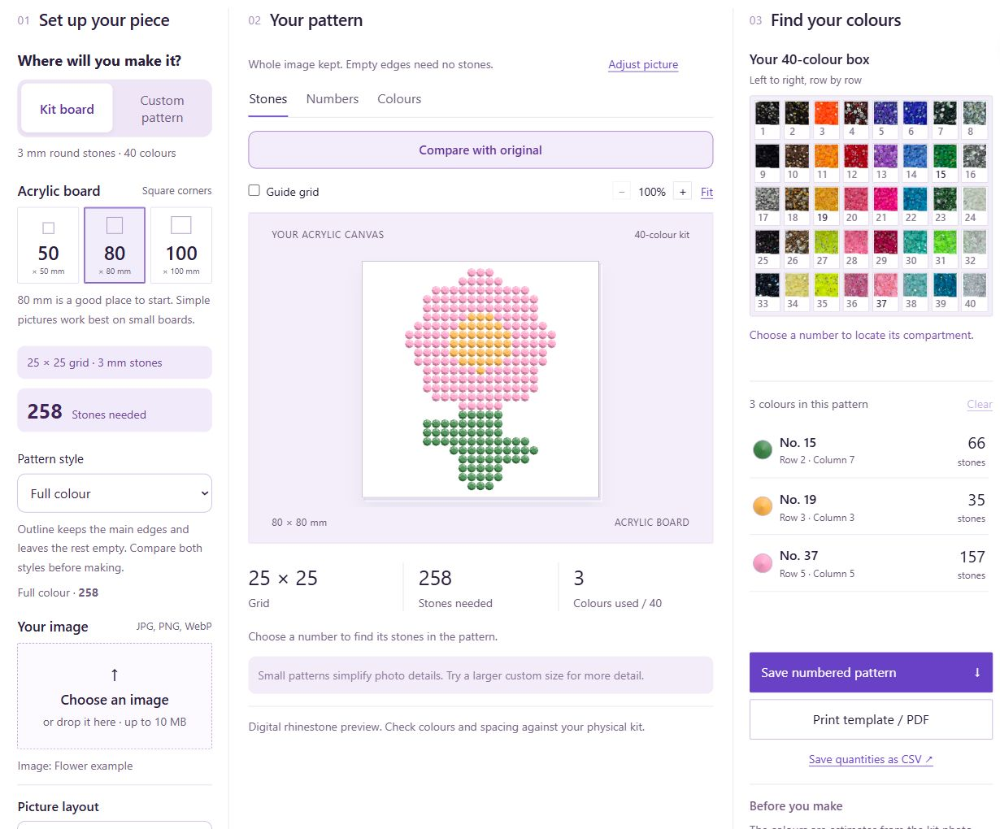
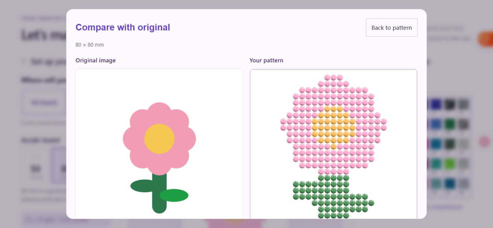
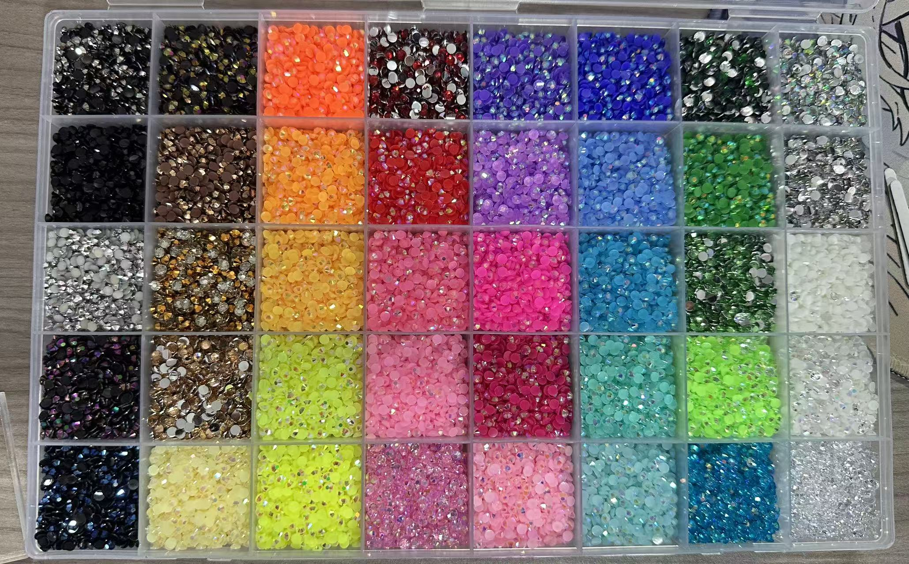
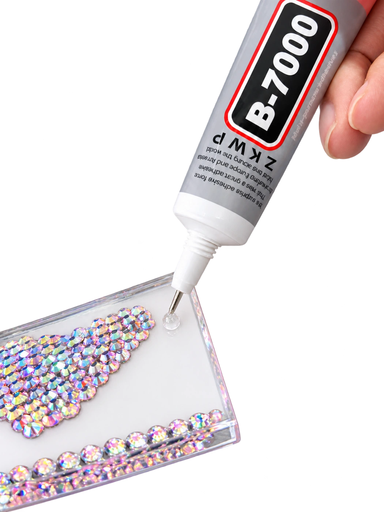
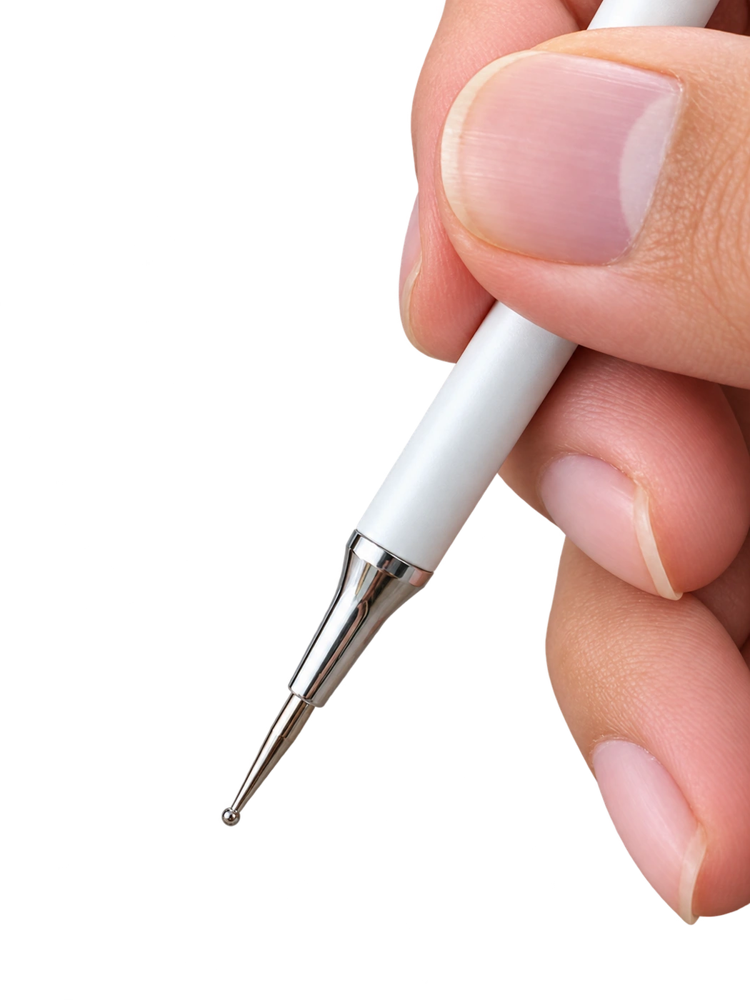
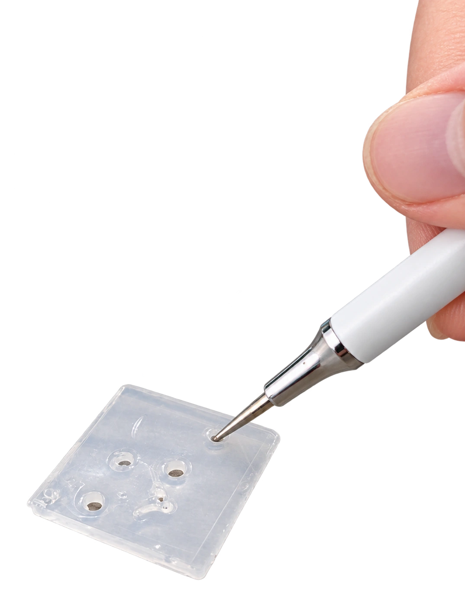
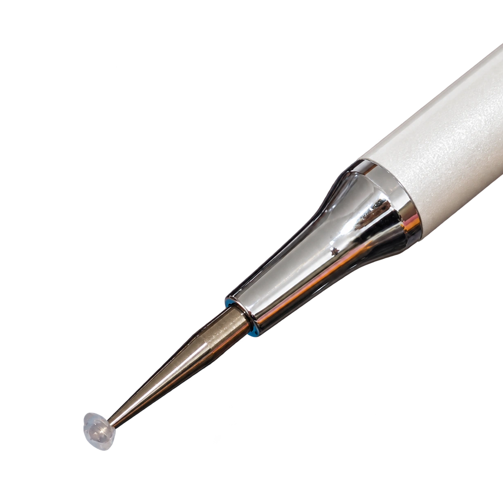
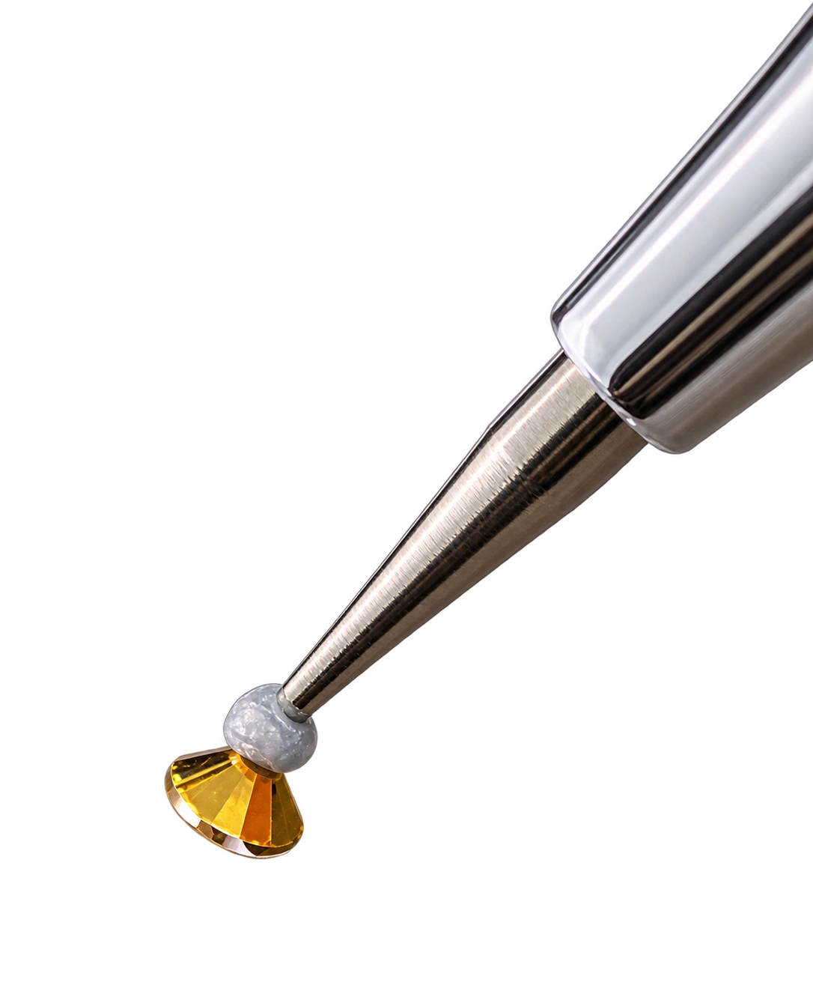
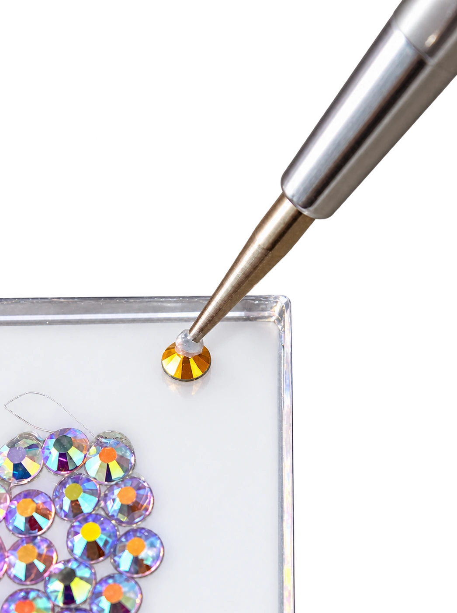

# WALLFID Rhinestone Studio

**简体中文** · [English](README.en.md) · [日本語](README.ja.md)

把喜欢的图片变成有编号的点钻图纸，再亲手拼出自己的作品。

WALLFID Rhinestone Studio 是围绕 **40 色点钻套装、3 mm 圆钻与透明亚克力板**设计的网页工具。选择图片和制作尺寸，即可查看点钻预览、对比原图、查找色号与用量，并导出制作图纸。图片处理在浏览器内完成，无需注册账户。

**开始体验：** [GitHub Pages](https://niuzipai-gif.github.io/wallfid-rhinestone-studio/) · [品牌网站](https://wallfid.pages.dev/) · [项目源码](https://github.com/niuzipai-gif/wallfid-rhinestone-studio)

## 从图片到作品

1. **选择制作尺寸。** 使用 50、80 或 100 mm 方板，也可以填写自定义宽高。
2. **导入喜欢的图片。** 支持 JPG、PNG、WebP，文件不超过 10 MB、解码后不超过 2,400 万像素。默认保留完整图片，也可调整裁切、缩放和位置。
3. **先看效果，再动手。** 对比原图，切换完整彩色或省钻轮廓，核对每种颜色的用量。
4. **保存图纸，按编号制作。** 导出编号 PNG、用量 CSV，或打印实际尺寸定位图纸。

“对比原图”同时显示未经处理的原图和当前已生成图案；打开对比不会改变图案、用量、选中的颜色或预览缩放。

## 主要功能

| 功能 | 用途 |
| --- | --- |
| 固定 40 色编号 | 图纸、用量清单与实物钻盒使用同一套 1–40 编号 |
| 原图对比 | 判断转换后的轮廓、颜色与细节是否适合制作 |
| 完整图片 / 填满裁切 | 默认不拉伸图片，未覆盖区域留空；需要时再调整构图 |
| 完整彩色 / 省钻轮廓 | 保留完整色块，或只保留主要边界，减少用钻 |
| 轮廓与颜色采样 | 简单插画优先保留连续线条与主要色块，再匹配固定色板 |
| 暗部照片增强 | 可选增强，帮助采样时保留暗照片中的亮色细节 |
| 自定义图案 | 宽高 12–600 mm，支持图像轮廓、矩形、圆形 / 椭圆、心形 |
| 编号与颜色定位 | 切换钻石、编号、颜色视图，点击色号查看相应位置 |
| PNG、CSV、实际尺寸打印 | 分别用于查看图纸、统计用量和板下定位；大图支持 A4 分页 |
| 手机与桌面布局 | 手机按“设置 → 图案 → 颜色”操作，桌面集中展示工作区 |

## 三种亚克力板与网格

套装使用透明、直角正方形亚克力板。在默认 **3 mm 中心间距**下，网格已按实物使用反馈修正为：

| 亚克力板尺寸 | 网格 | 最大位置数 |
| --- | --- | ---: |
| 50 × 50 mm | **15 × 15** | 225 |
| 80 × 80 mm | **25 × 25** | 625 |
| 100 × 100 mm | **32 × 32** | 1,024 |

最大位置数不是每张图案的固定用钻量。透明区域、去背景和轮廓模式可能留空；增大间距后，能容纳的网格数会减少。

打印时选择 **100% / 实际大小**，关闭页眉页脚，并测量图纸上的 **50 mm 校准线**。不要使用“适合页面”后直接作为实物定位依据。

## 40 色与实物顺序

从钻盒左上角开始，**每行由左到右，再向下一行**：第一行 1–8，第二行 9–16，第三行 17–24，第四行 25–32，第五行 33–40。使用时保持实物颜色与这个顺序对应。网页的盒格缩略图来自实物照片。

当前色板版本：<code>physical-sample-2026-10-13-row-major-40-v2</code>。

颜色 RGB 来自实物照片的正面 / 主体颜色估计，尽量避开背面和强反光，尚未经过仪器校色。反光、镀色和幻彩效果也会随光线变化，因此应先按**编号**找钻，再核对实物颜色。

## 实拍教学：从第一颗钻开始

先清洁并擦干表面；使用亚克力板时，撕去保护膜，将已核对实际尺寸的图纸固定在板下。网站提供六步实拍教学，点击照片可放大查看。

<table>
  <tr>
    <td width="33%"> <strong>1. 涂少量胶水</strong> 每次先做一小块区域。</td>
    <td width="33%"> <strong>2. 找到圆形细笔尖</strong> 使用图中细长金属端的小圆头。</td>
    <td width="33%"> <strong>3. 插入硅胶泥</strong> 轻压并转动一圈，带上少量硅胶泥。</td>
  </tr>
  <tr>
    <td> <strong>4. 检查笔尖</strong> 少量硅胶泥包住小圆头即可。</td>
    <td> <strong>5. 取起一颗钻</strong> 轻触有切面的正面，让平底朝向胶水。</td>
    <td> <strong>6. 对准、轻压、提笔</strong> 整颗钻的平底落在板内，轻压后提起笔。</td>
  </tr>
</table>

硅胶泥帮助笔尖**取钻**，胶水负责将钻石**固定在表面**。胶水用法及固化时间按胶水标签操作。

下载 **A5 双面操作指南**：[英文 PDF](assets/tutorial/WALLFID-hands-on-EN.pdf) · [中文 PDF](assets/tutorial/WALLFID-hands-on-ZH.pdf)。

## 语言支持

网站主体界面提供 **28 种语言**：欧盟 24 种官方语言，加上简体中文、繁体中文、日语和韩语。现有翻译仍需完整母语校对。

切换语言会保留当前图片、板型和图案；语言偏好保存于本地浏览器。翻译使用随站点提供的字典，不向翻译服务发送图片。

六步实拍教程的详细文案目前提供**英文、简体中文、繁体中文**；其他界面语言会使用英文教程。操作指南 PDF 目前提供中英文。

## 本地运行

这是可直接托管的静态网站。仓库根目录就是站点，无需框架构建，也无需安装运行时依赖。

~~~sh
git clone https://github.com/niuzipai-gif/wallfid-rhinestone-studio.git
cd wallfid-rhinestone-studio
python -m http.server 8766
~~~

用现代浏览器打开 [http://localhost:8766/](http://localhost:8766/)。Python 3 仅用于本地静态服务，图案处理在浏览器内运行。

## 验证与维护

准备 Node.js 20 或更高版本与 npm，无需执行 npm install：

~~~sh
npm test
~~~

该命令运行六组现有回归测试、JavaScript 语法检查和网站 / 三语文档的本地链接检查。

| 测试文件 | 检查范围 |
| --- | --- |
| sampling-wallfid.test.cjs | 细线、白底和透明区域采样 |
| image-flow.test.cjs | 图片构图、透明补边、采样和网格数量 |
| custom-pattern.test.cjs | 自定义尺寸、形状边界和打印分页 |
| languages.test.cjs | 28 语言文案覆盖、占位值与静态接入 |
| colour-contour.test.cjs | 连续轮廓、颜色族与固定编号 |
| small-pattern.test.cjs | 小图线条、主要颜色和零散噪点 |

修改发布内容后，审查变更并更新文件校验清单：

~~~sh
npm run manifest
npm run verify
~~~

GitHub Actions 会对推送和拉取请求执行相同检查。自动测试之外，发布前应实际查看上传图片、三种板型、原图对比、手机导航、下载与实际尺寸打印预览。

## 代码结构

| 文件 / 目录 | 职责 |
| --- | --- |
| index.html | 当前页面结构与脚本、样式入口 |
| app-localized.js | 图片操作、预览、对比、导出与界面交互 |
| pattern-core-spark.js | 固定色板、网格、颜色匹配、用量统计和打印分页 |
| image-sampling-wallfid.js | 图片构图、采样与轮廓保留 |
| languages-data.js、languages.js | 多语言字典与语言切换 |
| mobile-flow.js、mobile-flow.css | 手机端分步操作 |
| tutorial-data.js、real-tutorial.* | 教学文案、图片弹窗与指南链接 |
| assets/ | 网站插图、实物参考、教程照片、PDF 与字体 |
| docs/images/ | 三语说明使用的实际界面截图 |
| scripts/ | 便携检查与发布清单维护 |
| release-manifest.json | 发布文件的 SHA-256 校验值 |

实际运行入口以 index.html 加载的脚本为准。app-wallfid.js 是保留的基础版本，不应与 app-localized.js 同时加载。

## 部署

GitHub Pages 使用 main 分支的 / (root)。资源采用相对路径，可在项目子路径下使用；.nojekyll 支持直接发布静态文件。推送后需要等待 Pages 构建完成，再检查网站资源、教程照片、两份 PDF 和导出功能。

本仓库也可托管到其他静态平台。GitHub 同步与品牌站点发布是两项独立操作，向 GitHub 推送不会自动代表 Cloudflare 已部署同一版本。

## 图片处理与适用范围

- 选中的图片在浏览器内解码、采样和绘制；网站没有账号系统或图片上传后端。
- 首次打开网站、加载照片、字体和 PDF 仍会向托管平台发起正常请求。本地图像处理不等于访问网站完全不联网。
- 40 色和 3 mm 网格会简化照片、细小文字与复杂细节。较大图案可保留更多结构，但不能保证原图或颜色的完全还原。
- 用量表示图案需要多少颗钻；各色库存尚未录入，不能据此保证任意图案都能用一盒完成。
- 自定义尺寸用于平面定位。粘贴前应测量目标表面，并核对打印比例和实际摆放。
- 截图与点钻预览用于解释效果；实物定位以核对过比例的打印图纸为依据。

## 图片与字体

色板参考和六步教程使用实物照片；首屏作品及早期流程插图为生成式示意素材，其中的纸面网格不可当作定位模板。

Bodoni Moda Italic 随站点本地提供，遵循 [SIL Open Font License](assets/fonts/OFL.txt)，无需外部字体请求。仓库保存网站及公开素材，不会收集访客选中的图片。

网站会发送匿名访问与成功生成的汇总事件，用于改进工具。不会发送图片、文件名或身份，不使用访客身份 Cookie；可在页面底部关闭统计，且尊重 DNT / GPC。私人统计界面与访问密钥不包含在本仓库中。
